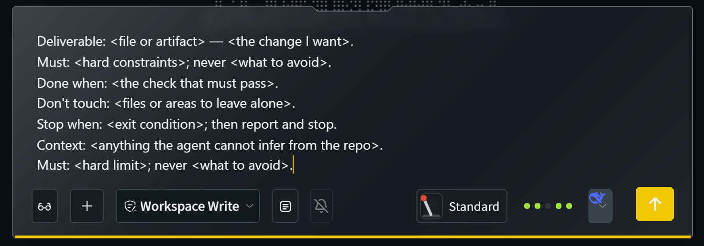
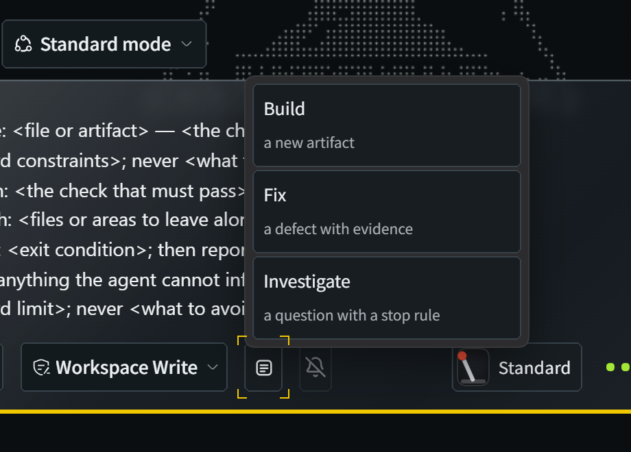
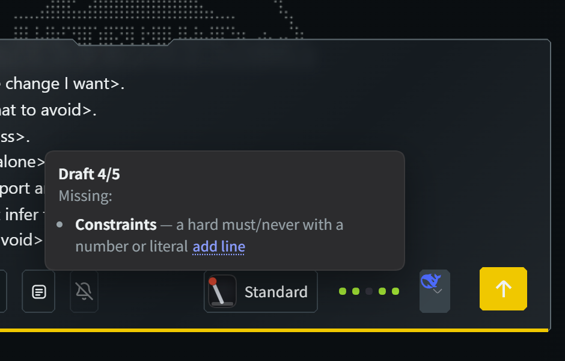

# dsh-coach



A quiet coach for [DeepSeek Harness](https://github.com/deepseek-ai) that keeps a
session cheap — by shaping the ask, handing off when the session has run long,
and noticing when the setup drifted.

Four small surfaces, no model calls, no system-prompt changes, and nothing is
ever sent for you.

## Why

Three habits keep an agent session cheap, and all three are easy to skip:

1. **One artifact per ask, with a done-when.** A prompt that names a single
   deliverable, one acceptance check and a stop rule costs far fewer turns than
   "fix the bug" followed by six rounds of clarification.
2. **A fresh session per task.** Long contexts are re-billed every step, and a
   task that grew out of a previous one inherits every token of it.
3. **A setup that stays where you put it.** Swapping model, effort or tool set
   mid-session invalidates the prefix cache and silently changes what the agent
   can do.

`dsh-coach` makes those three visible at the moment you can still act on them,
without nagging and without ever editing what you wrote.

## Screens

| Templates | Draft meter |
|---|---|
|  |  |
| Three six-line skeletons. An empty draft is replaced; a non-empty draft only gets an appended block. | Five dots, 0–5, with one line per missing piece and an **add line** that only appends. |

## Surfaces

| Surface | Where | What it does |
|---|---|---|
| **Template inserter** | composer tool row (page glyph) | `Build` / `Fix` / `Investigate` skeletons: deliverable, must/never, done-when, don't-touch, stop rule, context. |
| **Draft meter** | right of the model pill, five dots | Scores the draft 0–5 after a 300 ms debounce and lists each missing piece with one **add line** that only appends. Hidden for empty drafts and `/` commands. |
| **Freshness chip** | floating over the composer | Appears only on a real signal: setup drift · context at the red line · a new-task-shaped draft · a finished turn at amber. Offers *Write handoff* · *New session with handoff* · *Not now* (2 turns). |
| **Turn-tail line** | after a completed turn | One line when the turn looks finished and the context is at amber, with a **Hand off →** action. |
| **Drift dot** | conversation header corner | A dot whose hover text names the change — `model flash→pro`, `tools +1 (bash)`, `effort max` — after the model, effort or tool set moves mid-session. |

The chip's two actions share one click: the handoff file is written next to the
session's working directory, then a new session opens with the same text in its
draft. The old session is left untouched.

## Install

```bash
# from this repository
dsh plugin --profile web add github:Raikouzen/dsh-coach

# or from a checkout while developing
dsh plugin --profile web add link:/absolute/path/to/dsh-coach
```

Then restart the host (`/restart` or quit and start `dsh`). The bundle is
config-gated per feature, so any surface can be switched off without
uninstalling.

## Commands

| Command | What it does |
|---|---|
| `/handoff` | Writes `.dsh/handoff-<yyyyMMdd-HHmm>.md` next to the session's working directory and echoes it. Deterministic: objective, decisions, files touched, verification, open items — capped at 400 words. |
| `/coach` | The current pressure as a fraction of the compaction trigger, the thresholds, the handoff size, and the per-session feature switches. |
| `/coach --off meter` | Disables one surface (`meter`, `templates`, `nudge`, `drift`) for this session. `--on` restores it. |

Neither command calls a model.

## Configuration

Every field is optional; these are the defaults (`cordis.patch.yml`):

```yaml
meter: true           # draft meter
templates: true       # template inserter
nudge: true           # freshness chip and turn-tail line
drift: true           # drift dot
amber: 0.7            # fraction of the compaction trigger that counts as "long"
red: 0.9              # fraction that always shows the chip
compactionRatio: 0.8  # same arithmetic as dsh-compaction-basic
headroomTokens: 65536
handoffDir: .dsh
handoffMaxWords: 400
```

## How it works

**One projection, no prompt.** The host half folds session events into a single
`coachSetup` projection: the first request header (the setup the session started
from), the latest header (the setup now), the last request's token usage, the
recent asks, and the tool calls that touched files. The browser reads that view;
no domain ships prompt text, so the **system prompt is byte-identical with the
plugin installed or removed**.

**The threshold is the real one.** The chip's percentage is measured against the
same trigger `dsh-compaction-basic` acts on:

```
floor(min(ratio × contextWindow, contextWindow − completionTokens − headroomTokens))
```

so "70%" means the same thing to the coach and to the service that will compact
the session.

**What crosses the wire.** Down: the projection as plain JSON. Up: one
same-origin `POST /api/dsh-coach/handoff` that turns a click into a file. No
telemetry, no external requests, no model calls.

**Heuristics stay subordinate.** Every signal can be dismissed, every surface can
be disabled per session or in config, and the plugin never sends a message,
never rewrites a draft, and never changes model or effort.

## Good to know

- The chip needs at least one earlier ask in the session — the first message of a
  session is never nagged about.
- Dismissal lasts two turns and is remembered for the page session.
- `/coach --off <feature>` takes effect on the next fold, i.e. the next event.
- The meter is a heuristic, not a validator: it rewards a named deliverable, a
  done-when, a numeric or literal constraint, a stop rule, and a bounded size.

## Tests

17 tests, no network and no harness required:

```bash
node test/core.test.mjs     # fold, compaction arithmetic, drift, handoff composition
node test/client.test.mjs   # meter fixtures, topic-change fixtures, chip reasons
node test/host.test.mjs     # projection, /handoff, /coach, the handoff route
```

(`node --test <dir>` spawns a child per file, which the Harness file sandbox
blocks on Windows; invoke the files directly.)

## License

MIT — see [LICENSE](LICENSE).
